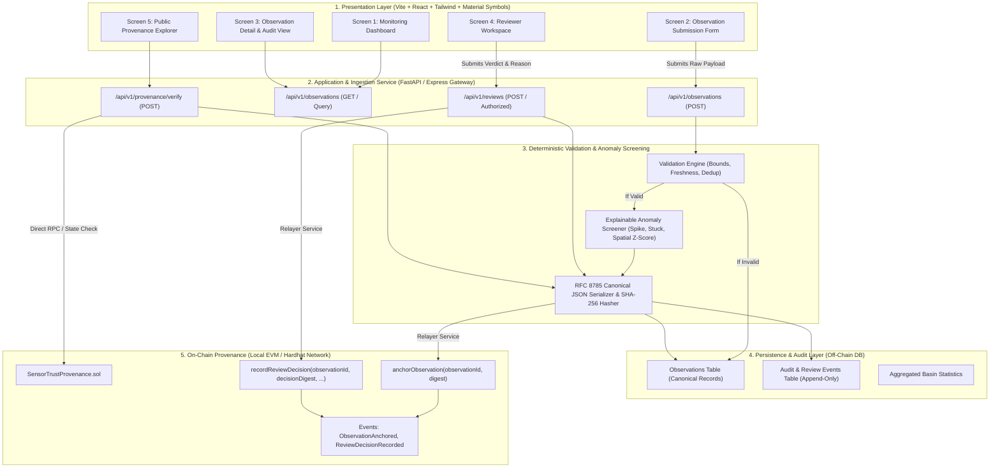
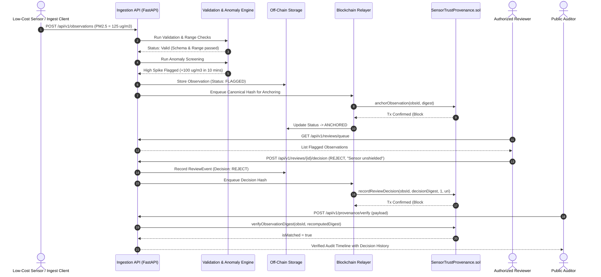

# SENSORTRUST — PHASE 1 MASTER SPECIFICATION
## System Architecture, Technical Blueprint & Frontend Design Specification
**Track:** Climate Data & Environmental Monitoring  
**Event:** IEEE ClimateChain Global Hackathon 2026  
**Status:** Approved Architectural Blueprint (Phase 1 Final)  
**Date:** October 2026  

---

## 1. Executive Architecture Summary

### 1.1 Product Mission & Strategic Positioning
**SensorTrust** is an AI-assisted environmental data integrity and tamper-evident blockchain provenance platform engineered for municipalities, atmospheric researchers, and citizen-science monitoring networks. 

Environmental observation networks face an acute epistemic dilemma: low-cost IoT devices and citizen sensors provide dense spatial-temporal coverage, but suffer from uncalibrated drift, hardware flatlining, malicious tampering, and inconsistent provenance. Official reference stations offer high accuracy but low spatial resolution. SensorTrust bridges this trust gap by combining:
1. **Deterministic Ingestion & Physical Validation:** Instant schema, physical range, clock drift, and deduplication verification.
2. **Explainable Multi-Tier Anomaly Screening:** Heuristic rate-of-change, stuck sensor, and spatial neighbor z-score screening with explicit acknowledgment when peer context is unavailable.
3. **Accountable Human Review Queue:** A role-authorized workflow requiring documented rationale for every acceptance, rejection, or recalibration action.
4. **Zero-PII Blockchain Provenance Anchoring:** Cryptographic SHA-256 digest anchoring on an EVM smart contract (`SensorTrustProvenance.sol`), establishing an immutable, append-only historical audit trail without exposing sensitive coordinates or raw device identifiers.

### 1.2 The Eight Core Architectural Principles
1. **Data Quality ≠ Physical Truth:** A validation pass or low anomaly score never proves an observation is physical reality; it proves adherence to physical bounds and peer consistency.
2. **AI Assists, Never Dictates:** Anomaly algorithms screen and rank risk with transparent evidence; they never silently discard observations or issue automated bans.
3. **Blockchain Preserves Evidence, Not Atmospheric Truth:** A blockchain transaction proves that a specific canonical digest existed and was attested at time $T$, protecting audit history against revisionist alterations.
4. **Privacy by Design:** Raw coordinates are quantized to a 2-decimal grid cell (~1.1 km resolution off-chain). Zero personal accounts, exact GPS points, or raw IP addresses are anchored on-chain.
5. **Strict Append-Only Audit History:** Review actions and recalibrations generate new sequential events with pointers. Historical records are never modified or purged.
6. **Evidence-Based Evaluation:** Anomaly performance is benchmarked against labeled confusion matrices (reporting Precision, Recall, and False Positive Rates).
7. **Honest Prototype Boundaries:** The system explicitly tags synthetic test records, simulated relayer responses, and local EVM testnet states.
8. **End-to-End Demonstrability:** A deterministic, 3-to-5 minute end-to-end evaluation scenario reproducible in any browser or test environment.

---

## 2. System Architecture & Component Interaction



---

## 3. Module Responsibility Matrix

| Module | Execution Context | Core Responsibilities | What It Must NEVER Do |
| :--- | :--- | :--- | :--- |
| **A. Frontend Application** | Client Browser (React + TS) | Render responsive views; provide input feedback; show anomaly explanations; trigger verification; display blockchain transaction states. | Execute cryptographic relayer private keys; enforce reviewer authorization client-side only; alter stored records. |
| **B. Ingestion & Validation** | Backend (FastAPI / Node) | Schema enforcement; physical PM2.5 range check (0..1000 µg/m³); timestamp freshness check (window: -24h to +5m); duplicate detection. | Fabricate missing metadata; silently correct invalid numbers; submit invalid payloads to blockchain. |
| **C. Anomaly Screening** | Backend / Worker | Rate-of-change calculation; stuck sensor flatline detection; spatial peer z-score comparison; generate structured reason codes and plain-English explanation. | Issue automated rejections without human review; invent synthetic peer data if no neighboring sensors exist. |
| **D. Human Review Service** | Backend (Authorized) | Authenticate reviewer identity; validate required justification string; record append-only decision record; trigger on-chain decision anchoring. | Allow unsigned/unjustified decisions; overwrite or delete earlier review decisions. |
| **E. Provenance & Blockchain** | EVM Smart Contract + Relayer | Deterministic SHA-256 / Keccak-256 storage; enforce observationId uniqueness; verify caller roles (`RELAYER_ROLE`, `REVIEWER_ROLE`); emit immutable events. | Store plaintext coordinates or user PII; validate atmospheric reality; allow unauthorized role assignments. |
| **F. Persistence & Audit Layer** | Database (SQLite / Postgres) | Store full canonical observation payload; cache verification statuses; maintain relationship between observations and append-only decision events. | Drop history tables; modify historical records in place. |

---

## 4. Technology & Dependency Decisions

- **Frontend Core:** React 19, TypeScript 5.7+, Tailwind CSS v4, Vite 6/8.
- **Component Primitives:** Built with accessible Tailwind/HTML5 patterns following shadcn/ui and Preline UI styling guidelines.
- **Iconography Standard:** Exclusively Google Material Symbols Outlined (`material-symbols-outlined`). Zero dependency on Lucide, FontAwesome, or Feather.
- **Deterministic Hashing:** RFC 8785 JSON Canonicalization Scheme + SHA-256 hex encoding (`0x...`).
- **Backend Service:** Python FastAPI (or Node.js Express companion) with Pydantic / TypeScript type validations.
- **Smart Contracts:** Solidity `^0.8.20`, compiled and deployed via Hardhat with standard OpenZeppelin-compatible role patterns.
- **EVM Execution Target:** Local Hardhat Node (`chainId: 31337`) for instantaneous, zero-cost, deterministic hackathon reproducibility. Optional testnet: Sepolia (`chainId: 11155111`).
- **End-to-End Testing:** Playwright CLI for headless Chromium user-journey automation.

---

## 5. Canonical Observation Data Contract

### 5.1 Observation Schema (PM2.5 MVP)
```typescript
export interface ObservationPayload {
  observationId: string;           // UUID v4 format
  sensorId: string;                // Pseudonymous sensor identifier
  pollutant: 'PM2.5';              // Locked to PM2.5 for MVP
  value: number;                   // Measured concentration in ug/m3
  unit: 'ug/m3';                   // Standardized unit
  timestampObserved: string;       // ISO 8601 UTC (e.g., 2026-10-23T11:00:00.000Z)
  timestampSubmitted: string;      // ISO 8601 UTC
  location: {
    gridLat: number;               // Truncated to 2 decimal places (~1.1 km)
    gridLon: number;               // Truncated to 2 decimal places (~1.1 km)
    countryCode: string;           // ISO 3166-1 alpha-2
    zoneId: string;                // Regional basin ID (e.g., "delhi-ncr-zone2")
  };
  sensorMetadata: {
    sensorType: 'OFFICIAL_REFERENCE' | 'LOW_COST_IOT' | 'CITIZEN_SCIENCE';
    calibrationStatus: 'FACTORY_CALIBRATED' | 'CO_LOCATED_VERIFIED' | 'EXPIRED' | 'UNKNOWN';
    firmwareVersion?: string;
  };
}
```

### 5.2 Deterministic Canonical Serialization Strategy
To guarantee reproducible cryptographic hashing across heterogeneous runtimes (Python, Node.js, Go, Solidity):
1. **Recursive Key Sorting:** Keys are sorted lexicographically by UTF-16 code units at every nesting level.
2. **Whitespace Stripping:** No whitespace between key-value separators (`:`) or element separators (`,`).
3. **Number Formatting:** Finite decimal representation; no exponential notation for standard numbers; integer trailing decimals omitted.
4. **Null Handling:** Explicit `null` values are serialized; `undefined` properties are omitted.
5. **Unicode Normalization:** Strings normalized via Unicode Normalization Form C (NFC).

```text
Input Object:
{ "value": 45.2, "pollutant": "PM2.5", "observationId": "obs-001", "location": { "gridLon": 77.20, "gridLat": 28.61 } }

Canonical Byte Stream (RFC 8785):
{"location":{"gridLat":28.61,"gridLon":77.2},"observationId":"obs-001","pollutant":"PM2.5","value":45.2}

SHA-256 Digest:
0x8d5c4146a7be74a625a83a0429f5f6406e22f28ebc9d64e9e43b6795dd34be01
```

---

## 6. API Contract (v1 REST Endpoints)

| Method & Route | Purpose | Auth | Request Body | Success Response | Error Codes |
| :--- | :--- | :--- | :--- | :--- | :--- |
| `GET /api/v1/health` | Service health & EVM connectivity | Public | None | `{"status":"HEALTHY","chainConnected":true}` | `503 Service Unavailable` |
| `POST /api/v1/observations` | Ingest, validate & screen observation | Sensor Key | `ObservationPayload` | `201 Created` with validation & anomaly result | `400 Bad Request`, `409 Duplicate ID`, `422 Unprocessable` |
| `GET /api/v1/observations` | List recent observations | Public | Query: `status, limit, offset` | `200 OK` `{"items":[...],"total":int}` | `400 Invalid Query` |
| `GET /api/v1/observations/{id}` | Retrieve complete enriched record | Public | None | `200 OK` `EnrichedObservation` | `404 Not Found` |
| `GET /api/v1/reviews/queue` | Retrieve observations flagged for review | Reviewer | Query: `severity, limit` | `200 OK` `{"queue":[...]}` | `401 Unauthorized` |
| `POST /api/v1/reviews/{id}/decision` | Record review decision & anchor on chain | Reviewer | `{"decision":"REJECT","reason":"..."}` | `200 OK` with review record & txHash | `400 Reason Missing`, `403 Forbidden`, `404 Not Found` |
| `POST /api/v1/provenance/verify` | Independently recompute hash & check chain | Public | `{"observationId":"...","payload":{...}}` | `200 OK` `{"isMatched":true,"blockNumber":...}` | `400 Malformed Payload`, `404 On-Chain Absent` |
| `GET /api/v1/metrics/summary` | Dashboard KPI summary | Public | None | `200 OK` `{totalObs, flaggedCount, ...}` | None |

### 6.1 Sample API Payloads
**Submission Response (`201 Created`):**
```json
{
  "observationId": "urn:uuid:7c9e6679-7425-40de-944b-e07fc1f90ae7",
  "observationDigest": "0x8d5c4146a7be74a625a83a0429f5f6406e22f28ebc9d64e9e43b6795dd34be01",
  "status": "FLAGGED",
  "validation": {
    "isValid": true,
    "validatedAt": "2026-10-23T11:05:00.120Z",
    "checks": { "schemaValid": true, "rangeValid": true, "timestampFresh": true, "duplicateDetected": false },
    "rejectionReasons": []
  },
  "anomaly": {
    "score": 0.65,
    "severity": "HIGH",
    "reasonCodes": ["ANOMALY_RAPID_SPIKE"],
    "explanation": "Sudden PM2.5 delta of +82.4 ug/m3 in 12.0 minutes (rate: 6.87 ug/m3/min).",
    "flaggedForReview": true
  },
  "provenance": {
    "status": "ANCHORING_PENDING",
    "networkId": "hardhat-31337"
  }
}
```

---

## 7. AI & Data-Quality Screening Design

### 7.1 Multi-Tier Screening Pipeline
```text
Raw Observation
  ├── Tier 1: Schema & Range Invariant Check (0 <= PM2.5 <= 1000 ug/m3)
  ├── Tier 2: Freshness Window & Sensor Timestep Deduplication
  ├── Tier 3: Rate-of-Change Heuristic (Delta > 40 ug/m3 within <= 30 mins)
  ├── Tier 4: Hardware Fault Screener (>= 5 consecutive identical values)
  ├── Tier 5: Spatial Cluster Comparison (Peer Mean, Std Dev, Z-Score >= 3.0)
  └── Tier 6: Context Availability Gate (Acknowledges lack of peers)
```

### 7.2 Model Evaluation Strategy (P1 Enhancement)
If machine learning (e.g. Scikit-learn Isolation Forest or One-Class SVM) is evaluated in Phase 3:
- **Baseline Training Data:** 10,000 synthetic + verified historical observations representing standard diurnal traffic patterns.
- **Evaluation Metric Targets:**
  - Precision: $\ge 0.88$
  - Recall (Sensitivity to real sensor degradation): $\ge 0.92$
  - False Positive Rate: $\le 0.06$ (to avoid reviewer queue fatigue)
- **Confusion Matrix Format:**
```text
                   Predicted Normal    Predicted Anomaly
Actual Normal            9,400                 600 (FP)
Actual Fault               80                 920 (TP)
```

---

## 8. Smart Contract & Security Boundaries

### 8.1 Contract Specifications (`SensorTrustProvenance.sol`)
- **Language:** Solidity `^0.8.20`
- **Compiler Optimization:** Runs: 200
- **Access Control:** Role-Based Access Control (`admin`, `RELAYER_ROLE`, `REVIEWER_ROLE`).
- **Core Storage:**
  - `mapping(bytes32 => ObservationRecord) observations`
  - `mapping(bytes32 => ReviewEvent[]) reviewHistories`
- **Security Invariants:**
  1. Once anchored, an `observationDigest` cannot be updated or removed.
  2. Attempting to anchor an already existing `observationId` reverts with `"SensorTrust: observationId already anchored"`.
  3. Review decisions are append-only; calling `recordReviewDecision` pushes to a dynamic array preserving chronological order.
  4. Only accounts granted `REVIEWER_ROLE` can invoke `recordReviewDecision`.

---

## 9. Frontend Information Architecture & Wireframes

### Screen 1 — Monitoring Dashboard
- **Header:** Network status indicator (Local EVM Connected / Disconnected), active basin selector, role badge.
- **Metric Cards:** Total Ingested (e.g. 1,428), Clean / Auto-Anchored (1,312), Flagged for Review (84), Human Reviewed (32).
- **Recent Stream Table:** Timestamp, Sensor ID, Value badge (Color-coded: Normal Emerald, Flagged Amber, Rejected Rose), Provenance link.

### Screen 2 — Observation Ingestion
- **Form Controls:** Sensor Identifier, PM2.5 Measured Value (µg/m³), Observation Timestamp (with "Current UTC" quick button), Grid Coordinates (Lat/Lon with 2-decimal warning), Sensor Type, Calibration Status.
- **Client Feedback:** Live inline bounds validation, immediate error messages, single-click "Load Deterministic Demo Spike" button.

### Screen 3 — Observation Detail & Audit
- **Measurement Card:** Large numeric readout with AQI severity categorization.
- **Validation Card:** Checklist of 4 deterministic gates with timestamp.
- **Anomaly Evidence Card:** Visual delta rate metric, peer comparison scatter plot / table, plain-English reason summary.
- **Verification Trigger:** "Verify Against Blockchain" button with instant digest match indicator.

### Screen 4 — Reviewer Workspace
- **Queue Panel:** Sorted by anomaly risk score (Critical down to Low).
- **Inspection Split-View:** Selected observation metadata and anomaly evidence on the left; decision action box on the right.
- **Action Form:** Decision radios (`Approve`, `Reject`, `Request Recalibration`), mandatory Justification input (minimum 10 characters), submit button.

### Screen 5 — Public Provenance Explorer
- **Search Header:** Search by Observation UUID or Transaction Hash.
- **Verification Banner:** Green "Cryptographically Verified" or Red "Digest Mismatch / Tampering Detected".
- **Chronological Audit Trail:** Step 1 (Ingested & Canonicalized), Step 2 (On-Chain Anchored), Step 3 (Reviewer Decision with reason and reviewer address).

---

## 10. End-to-End Workflow Sequence



---

## 11. Recommended Repository Structure

```text
sensortrust/
├── .github/
│   └── workflows/
│       └── test-and-gate.yml         # CI workflow running linter, unit tests, and Playwright
├── contracts/                        # Solidity Smart Contracts (Hardhat)
│   ├── contracts/
│   │   └── SensorTrustProvenance.sol # Provenance registry contract
│   ├── test/
│   │   └── SensorTrustProvenance.test.ts # Hardhat contract unit tests
│   ├── scripts/
│   │   └── deploy.ts                 # Local Hardhat deployment script
│   └── hardhat.config.ts
├── backend/                          # FastAPI Backend Service
│   ├── app/
│   │   ├── api/                      # REST endpoints (observations, reviews, provenance)
│   │   ├── core/                     # Canonicalization & config
│   │   ├── models/                   # Pydantic schemas
│   │   ├── services/                 # Validation, Anomaly, Relayer
│   │   └── main.py
│   ├── tests/                        # Backend unit & integration tests
│   └── requirements.txt
├── frontend/                         # React SPA (Vite + Tailwind + TS)
│   ├── src/
│   │   ├── components/               # UI components (Header, Dashboard, ReviewQueue, etc.)
│   │   ├── core/                     # Shared canonicalization & validation logic
│   │   ├── types/                    # TypeScript interfaces & enums
│   │   ├── App.tsx
│   │   └── main.tsx
│   ├── tests/
│   │   └── e2e/                      # Playwright E2E browser tests
│   ├── package.json
│   └── vite.config.ts
├── docs/                             # Architecture blueprints & handoff guides
│   ├── SENSORTRUST_PHASE1_SPECIFICATION.md
│   └── architecture_diagrams/
└── README.md
```

---

## 12. Security, Privacy & Failure Handling

### 12.1 Privacy Threat Model & Mitigations
- **Threat: Citizen Sensor Geolocation Stalking:** High-resolution GPS can pinpoint residential homes.
  - *Mitigation:* Explicit truncation to 2 decimal places (~1.1 km bounding box) off-chain. Raw GPS never enters canonical digest.
- **Threat: On-Chain Leakage of PII:** Storing reviewer emails or device serials on public ledgers.
  - *Mitigation:* Only pseudonymous IDs (`reviewer:0x...`) and SHA-256 hashes are anchored on-chain.

### 12.2 Blockchain Failure & Degradation Modes
- **Relayer Offline / Gas Spike:** Observations are flagged `ANCHORING_PENDING` in the database and re-queued via exponential backoff.
- **Contract Revert (Duplicate ID):** API catches revert and responds with `409 Conflict`, preserving local record state.
- **UI Degradation Notice:** When the blockchain node is unreachable, the UI clearly displays `Network Unavailable - Local Audit Active` rather than falsely claiming on-chain confirmation.

---

## 13. Testing Strategy & Quality Gates

1. **Unit Tests (Pure Logic):** 100% coverage on canonical serialization, hash generation, range validation, and anomaly heuristics.
2. **Smart Contract Tests (Hardhat):** Test duplicate prevention, access control reverts, event emission, and append-only decision trail.
3. **E2E Browser Tests (Playwright):**
   - Flow 1: Submit valid observation -> Verify instant ingest and clean status.
   - Flow 2: Submit anomalous spike -> Verify high-risk flag in Reviewer Queue.
   - Flow 3: Reviewer rejects observation with reason -> Verify state change and on-chain event.
   - Flow 4: Independent verification -> Verify green digest match on Explorer screen.
   - Flow 5: Tampered payload test -> Submit modified value to verifier and assert red mismatch alert.

---

## 14. Scope & Deadline Management (October 25, 2026 Target)

### P0 (Essential Hackathon Scope — Mandatory)
- [x] Complete Phase 1 Architectural Specification & Data Contracts.
- [ ] React UI with 5 core screens (Dashboard, Ingestion, Details, Reviewer Queue, Explorer).
- [ ] FastAPI ingestion and deterministic range/freshness validation.
- [ ] Rule-based anomaly screening (Spike, Stuck sensor, Spatial Z-Score).
- [ ] Solidity provenance contract on local Hardhat network.
- [ ] End-to-end reproducible 3-minute hackathon demo script with deterministic seed data.

### P1 (Enhancements — Only if P0 is completely tested by Oct 24)
- [ ] Lightweight Scikit-learn Isolation Forest model with documented confusion matrix.
- [ ] Sepolia public testnet deployment with Etherscan verification links.
- [ ] Exportable Cryptographic Audit Certificate (PDF / JSON-LD).

---

## 15. Handoff Checklist: Phase 2 (Google AI Studio)

1. [x] **Locked Component Libraries:** Use Tailwind CSS with shadcn/ui-inspired primitives; strictly Google Material Symbols Outlined.
2. [x] **Canonical Serialization Module:** Adopt `canonicalizeJson()` and `computeSha256HexSync()` from `src/core/canonicalize.ts`.
3. [x] **Status State Machine:** Align all badge colors and state transitions with `ObservationStatus` enum.
4. [ ] **Screen Implementation Sequence:**
   - Step 1: Implement responsive `Header.tsx` and navigation tab bar with EVM network status pill.
   - Step 2: Implement `Screen 1 — Monitoring Dashboard` with KPI metrics and recent activity table.
   - Step 3: Implement `Screen 2 — Ingestion Form` with quick "Load Spike Sample" preset button.
   - Step 4: Implement `Screen 3 — Observation Detail` with visual anomaly evidence card and verify button.
   - Step 5: Implement `Screen 4 — Reviewer Workspace` with queue and mandatory justification form.
   - Step 6: Implement `Screen 5 — Public Provenance Explorer` with live SHA-256 tamper verification check.

---

## 16. Handoff Checklist: Phases 3–6 (Antigravity)

1. **Phase 3 (Backend & Anomaly Service):**
   - Set up Python FastAPI service matching the REST routes in Section 6.
   - Implement deterministic validation rules and explainable anomaly screening.
   - Seed database with deterministic demo dataset (Normal observations, Spiked observations, Flatlined observations).
2. **Phase 4 (Solidity Smart Contract & Hardhat):**
   - Deploy `SensorTrustProvenance.sol` to local Hardhat node (`31337`).
   - Grant `RELAYER_ROLE` to the backend relayer address.
   - Test event listening and transaction confirmation receipt.
3. **Phase 5 (End-to-End Integration):**
   - Connect Frontend API client to FastAPI backend.
   - Verify transaction hash link generation and real-time state synchronization.
4. **Phase 6 (Playwright E2E & Hackathon Demo Delivery):**
   - Execute automated Playwright test suite for all 5 user flows.
   - Rehearse 3-minute hackathon pitch: Ingest -> Flag -> Review -> Anchor -> Verify.
